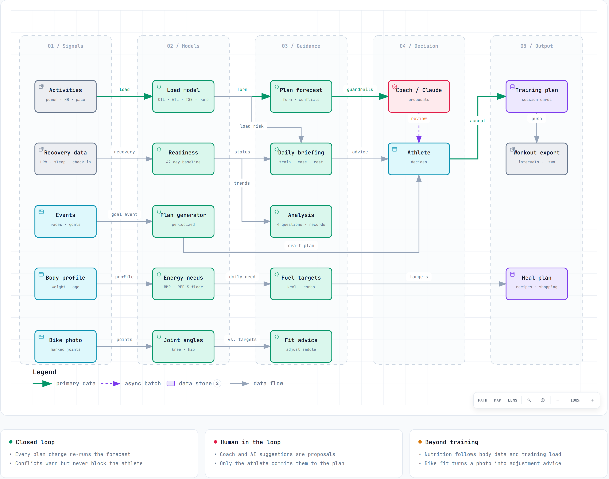
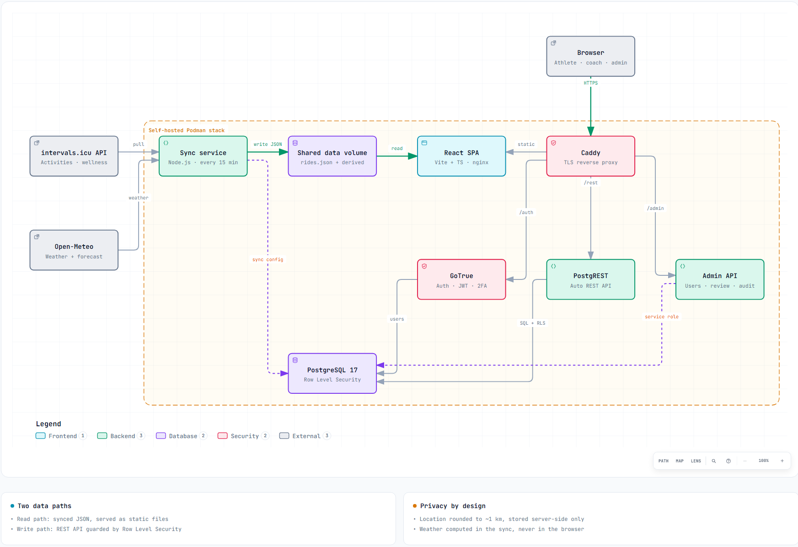

# Training Dashboard

**A coaching platform for endurance athletes that turns raw training data into a clear daily decision: train as planned, ease off, or recover.**

🔗 **Live:** [training-dashboard.clear-solutions-it.com](https://training-dashboard.clear-solutions-it.com) — public landing page with waitlist, dashboard behind login.

---

## The problem

Training data lives everywhere: power and heart rate on the bike computer, HRV and sleep on the watch, the plan in a spreadsheet, the coach in a chat. Platforms like intervals.icu show the numbers — but the athlete still has to answer the real question alone:

> *"Given how I slept, how hard the last weeks were and what my plan says — what should I do today?"*

## The solution

Training Dashboard adds a **coaching layer** on top of the raw data. It fuses load, recovery and the athlete's own morning check-in into one daily recommendation, forecasts how every plan change affects form, and lets athletes, coaches and an AI assistant work on the same plan — with the athlete always making the final call.

Built for cycling first, with running and swimming as first-class sports for triathletes.

---

## Features

### Daily guidance
- **Daily briefing** — one status (train / reduce / recover) fused from readiness, training-stress balance and load risk. Red recovery signals always override a green form value.
- **Readiness** — HRV, resting heart rate and sleep of the last 7 days against a rolling 42-day personal baseline, sharpened by a 30-second **morning check-in** (sleep, energy, legs, mood).
- **Load guard** — early warnings for overload: fitness ramp rate, Foster monotony and strain, plus a multi-sport governor for triathletes.

### Planning
- **Interactive weekly planner** — drag and drop sessions between days, with structured workouts built from repeatable blocks.
- **Plan generator** — creates a periodized plan (pyramidal, polarized, linear or block) from weekly hours, training days and goal event, including recovery weeks, taper and test days.
- **Forecast and conflict detection** — every change re-projects fitness, fatigue and form and checks a rule set (form drop, back-to-back hard days, ramp rate, event proximity). It warns, it never blocks.
- **Plan vs. actual** — completed activities are matched to planned sessions automatically.
- **Export** — push structured workouts to intervals.icu (deduplicated) or download them as `.zwo` files for Zwift and MyWhoosh.

### Coaching and collaboration
- **Roles** — athlete, coach and admin, enforced in the database, not just in the UI.
- **Proposal workflow** — coaches change sessions directly or submit proposals; the athlete reviews old vs. new side by side and accepts or declines.
- **AI coach without an API bill** — a coach panel builds a complete briefing (profile, events, plan, actuals, wellbeing, forecast) for a Claude chat. The answer is validated (structure and semantics) and lands as regular proposals in the same review flow as a human coach.

### Analysis
- **Four guiding questions** instead of a wall of charts: *Am I getting stronger? Can I handle the load? How do I recover? What is holding me back?* — each with a verdict and synchronized metric traces.
- Power and pace curves, intensity distribution, aerobic efficiency and HR decoupling, FTP history and forecast, personal records, consistency calendar, periodization compliance.

### Nutrition
- **Daily fuel targets** derived from body data and the planned sessions, with a safety floor against low energy availability (RED-S).
- **Meal planning** — day and week plans built from a shared recipe library, intolerance filter, automatic shopping list and a cooking mode with adjustable servings.
- **Community recipes** — athletes submit recipes, which go through a review flow with votes, ratings and comments.

### More
- **Bike fit** — joint angles measured from a photo and compared with established target ranges, with directional adjustment advice.
- **Events** — races with priority, countdown and results, linked to the plan and the FTP goal.
- **Self-service onboarding** — invitation link, password, profile basics, own intervals.icu connection; no server change needed for a new athlete.
- **Account security** — two-factor authentication, data export, account deletion, admin audit log.

---

## How training data steers the plan

<picture>
  <source media="(prefers-color-scheme: dark)" srcset="assets/coaching-flow-dark.png">
  
</picture>

## System architecture

<picture>
  <source media="(prefers-color-scheme: dark)" srcset="assets/architecture-system-dark.png">
  
</picture>

The platform uses **two data paths**:

| Path | What flows | How |
|---|---|---|
| **Read path** | Activities, power curves, wellness, weather | A sync service pulls external sources every 15 minutes and publishes derived JSON, served as static files — fast and cache-friendly. |
| **Write path** | Plans, proposals, check-ins, goals, events, recipes, accounts | A REST API on PostgreSQL. Every table is protected by Row Level Security, so permissions hold even if the UI is bypassed. |

---

## Tech stack

| Area | Technology |
|---|---|
| Frontend | React, TypeScript, Vite, React Query, Framer Motion, custom SVG chart engine |
| Domain logic | Pure, framework-free JavaScript modules with JSDoc types |
| Backend | PostgreSQL 17, PostgREST, GoTrue (auth, JWT, 2FA), Node.js admin API |
| Data sync | Node.js service, intervals.icu API, Open-Meteo |
| Infrastructure | Self-hosted Podman stack behind Caddy, OCI images on GHCR |
| Quality | Vitest, Node test runner, ESLint, Fallow code-health analysis |
| CI/CD | GitHub Actions, versioned releases with generated changelogs, Dependabot |

## Engineering highlights

- **Strict layered architecture** — `core` (pure calculations) → `api` (I/O boundary) → `hooks`/`features` (orchestration) → `components`/`charts` (rendering). Business logic never touches the DOM, storage or network, which keeps it fully unit-testable.
- **Pluggable sports** — zones and metrics per sport live in their own modules (`cycling`, `running`, `swimming`), so a new sport does not touch the core.
- **Consistent error contract** — every fallible operation returns a typed `Result` (`ok` / `error.code`) instead of throwing across layers.
- **Runtime schema validation** of all synced data before it reaches the UI.
- **3,700+ automated tests** across the app, the sync pipeline and the admin API, including golden-master tests for the fitness model and the plan generator, plus a dedicated Row Level Security test suite.
- **Release discipline** — production runs pinned, versioned images only; every release ships with an auto-generated changelog.

## Privacy and security

- **Location data never leaves the server.** Coordinates for weather are rounded to about 1 km, stored in an owner-only table and used only by the sync service. The browser receives weather values, never coordinates.
- **Pseudonyms only.** Athletes appear under self-chosen display names; no real names in code, data or UI.
- **Least privilege.** Row Level Security on every table; the service role is used only server-side. Private notes stay private, even from the coach.
- **Self-hosted.** All personal data stays on infrastructure we operate — no third-party cloud database.

---

## Status and roadmap

Training Dashboard is in **private beta** and in daily use by a small group of athletes and a coach.

- ✅ Coaching layer, planner, generator, analysis, nutrition, bike fit
- ✅ Multi-sport (cycling, running, swimming)
- ✅ Self-hosted production stack with versioned releases
- 🔜 Public sign-up — **join the waitlist on the [landing page](https://training-dashboard.clear-solutions-it.com)**
- 🔜 Direct device integrations, reducing the dependency on third-party data platforms

## About

Designed and built by **Alex Müller** — product, architecture, implementation and QA. The project started as a personal training tool and as a real-world practice project during QA training, and grew into a full multi-user platform.

- 💼 [LinkedIn](https://www.linkedin.com/in/alexander-mueller89)
- 📁 [QA portfolio](https://github.com/Stuhlsen/Portfolio)

## License

Copyright © 2026 Alex Müller. **All rights reserved.**

The source code is publicly visible for evaluation and portfolio purposes only. No permission is granted to use, copy, modify or distribute it without prior written consent. See [LICENSE](LICENSE).
